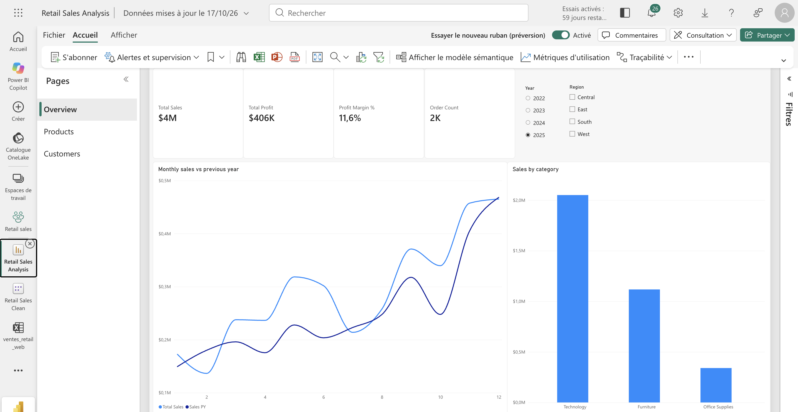
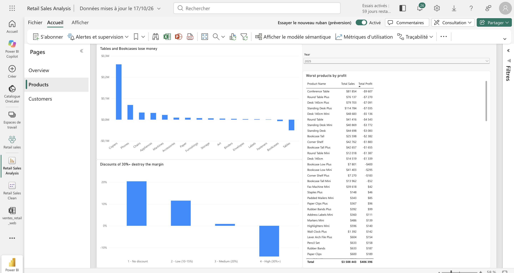
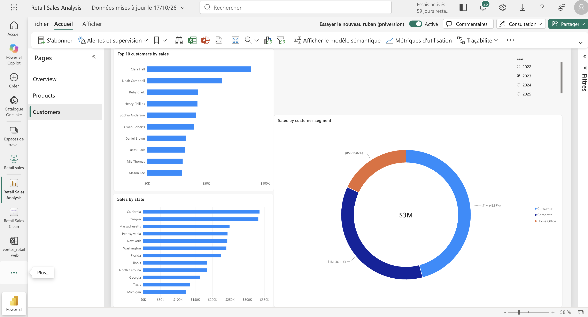

# Retail Sales Analysis in Power BI

I wanted a project that looks like real analyst work, not just a pile of charts. So I took four years of retail sales (2022-2025), built a Power BI report around them, and tried to answer a simple question: **where does this business make money, and where does it quietly lose it?**

> The data is **synthetic**. I used a generated dataset so I could focus on the method. The findings illustrate how I analyse, not how a real company performs.

## What the report looks like

| Overview | Products | Customers |
|---|---|---|
|  |  |  |

## What I found

The business looks healthy at first glance: **$11.7M in sales, $1.5M in profit, a 12.8% margin**, and sales growing every year (+6.5% in 2023, +14.3% in 2024, +15.4% in 2025). But a few things stand out once you dig in:

- **Discounts are the biggest lever.** Margin is 21.6% with no discount and drops to 4.0% at a 20% discount. From 30% it turns negative (-10.2%, and -28.6% at 50%).
- **Furniture loses money overall** ($43K lost on $3.47M of sales). Tables (-$148K) and Bookcases (-$16K) are the culprits.
- **Copiers carry the business:** $965K of profit at a 29% margin. Machines are the opposite: $2.13M in sales but only a 4% margin.
- **Sales peak at the end of the year.** November and December make up 26.4% of annual sales.
- **Region matters.** West (16.0%) and East (13.8%) are far more profitable than South (9.9%) and Central (8.8%).
- **Customers are fairly spread out.** The top 10 account for 15.9% of sales, and Consumer is the largest segment at about half of revenue.

## What I would recommend

1. Cap discounts at 20%, since anything above 30% loses money.
2. Look again at pricing and sourcing for Tables and Bookcases.
3. Push Copiers and Phones, and find out why Machines earn so little.
4. Build stock before November.
5. Work on profitability in Central and South.

## How it's built

The model is a **star schema**: one fact table (`Orders`, 11,955 order lines) surrounded by three dimensions (`Customers`, `Products`, `Calendar`). Each dimension connects to `Orders` with a one-to-many relationship.

On top of it I wrote **24 DAX measures** (all in [`measures.dax`](measures.dax)). A few I'm happy with:

```dax
Sales PY = CALCULATE([Total Sales], SAMEPERIODLASTYEAR('Calendar'[Date]))

Rolling 3M Sales =
    CALCULATE([Total Sales], DATESINPERIOD('Calendar'[Date], MAX('Calendar'[Date]), -3, MONTH))

Customers with Loss =
    COUNTROWS(FILTER(VALUES(Customers[Customer ID]), [Total Profit] < 0))

Top 10 Customers Share =
    DIVIDE(
        CALCULATE([Total Sales], TOPN(10, ALL(Customers[Customer ID]), [Total Sales])),
        CALCULATE([Total Sales], ALL(Customers))
    )
```

The report has three pages: **Overview** (KPIs, monthly sales against last year, sales by category), **Products** (profit by sub-category, margin by discount band, worst products) and **Customers** (top customers, segments, states).

**About the data preparation:** the raw file I started from had deliberate quality issues (duplicate lines, empty discounts, inconsistent text). I loaded a cleaned version into the model: duplicates removed, empty discounts set to 0, text standardised, plus two derived columns (`Delivery Days` and `Discount Band`). Both files are in the repo.

## What I learned

- How much a clean **date table** matters: year-over-year and rolling calculations only work properly with one.
- How **filter context** really behaves. `CALCULATE`, `FILTER` and `TOPN` stopped being abstract once I had to check my own numbers.
- That a good model beats a fancy chart. I validated my measures with queries in DAX query view against totals I computed separately (11,955 rows, $11,707,820 in sales).
- Working around limits: I'm on a Mac, so I built everything in **Power BI Service (the browser)** instead of Power BI Desktop.

## What I'd do next

- Redo the cleaning myself in **Power Query** starting from the raw file.
- Rebuild the report in Power BI Desktop and publish the `.pbix`.
- Dig into why margin dropped in some months of 2025 (September, November, December) by crossing it with discount level.

## Repository contents

```
retail-sales-powerbi/
├── README.md
├── measures.dax                      # all 24 DAX measures
├── data/
│   ├── retail_sales_en_clean.xlsx    # cleaned data loaded into the model
│   └── retail_sales_en.xlsx          # raw data with intentional quality issues
└── screenshots/
    ├── overview.png
    ├── products.png
    └── customers.png
```

---

*Built with Power BI Service, DAX and Excel.*
